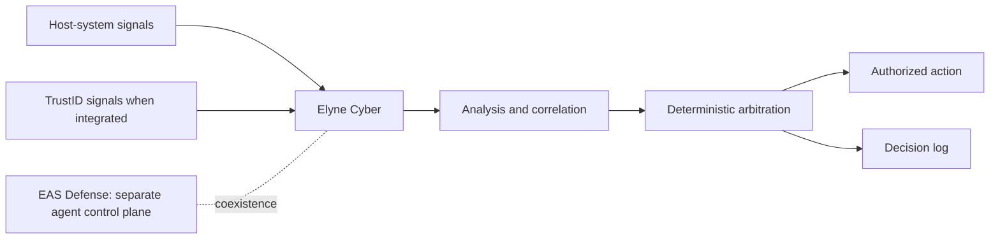

# Elyne Cyber — public architecture

**English · [Français](architecture.md)**

Elyne Cyber provides local defense for the host system. It is **functionally separate** from EAS Defense, which governs agent actions and decisions. Cyber Red and Cyber Hybrid are distinct catalogue variants; Cyber results cannot automatically be transferred to them. **Cyber Red** does not refer to Elyne Red Unified, the campaign platform supplied with EAS.

Local models may contribute analysis. Their output alone does not authorize an action; rules and policies govern execution. Functional independence from EAS does not imply complete OS privilege separation in every configuration.

Current Cyber source associated with the R45 candidate already resides in the private EAS kit repository; this public repository does not duplicate source. See [evidence and limits](evidence.en.md).
