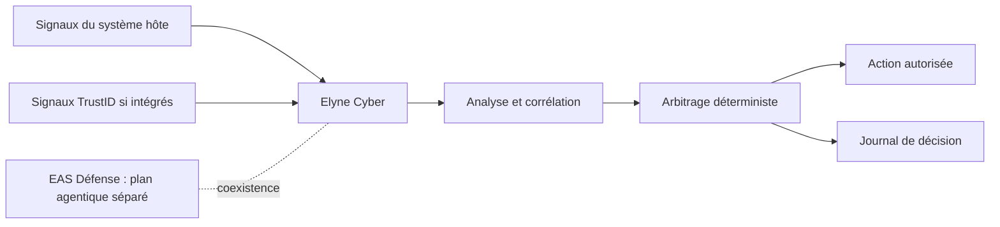

# Elyne Cyber — architecture publique

**Français · [English](architecture.en.md)**

Elyne Cyber est la défense locale du système hôte. Elle est **fonctionnellement distincte** d'EAS Défense, qui traite les décisions et actions agentiques. Les éditions Cyber Red et Cyber Hybrid sont des déclinaisons distinctes du catalogue, et leurs garanties ne se déduisent pas automatiquement de celles d'Elyne Cyber. **Cyber Red** ne désigne pas Elyne Red Unifiée, la plateforme de campagne fournie avec EAS.

Des modèles locaux peuvent contribuer à l'analyse. Leurs sorties ne constituent pas, à elles seules, une autorisation d'action : celle-ci dépend de règles et de politiques. L'indépendance fonctionnelle d'EAS ne garantit pas une séparation de privilèges OS complète dans chaque configuration.

La source actuelle de Cyber liée au candidat R45 est déjà conservée dans le dépôt privé du kit EAS ; ce dépôt public ne duplique aucun code. Voir [preuves et limites](evidence.md).
